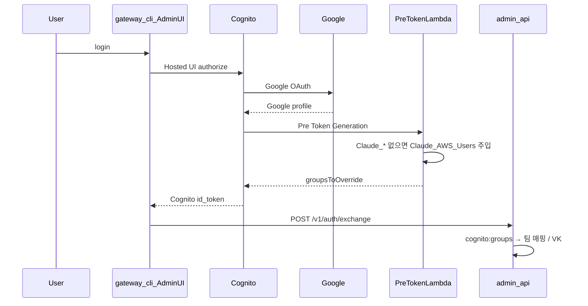

# Google Cognito Federation + 기본 그룹 Claude_AWS_Users

## 목표 동작



- **포털** (`html/` + `/portal/*`): 변경 없음 (Google ID token 직접 검증 유지).
- **gateway-cli / Admin UI**: Cognito Hosted UI에서 **Google**로 로그인 → 여전히 **Cognito `id_token`** 을 exchange.
- User Pool / Issuer / Client ID는 **기존 풀 유지** (교체 없음).
- 계정 SoT: **federated Cognito 사용자**. 기존 native Cognito 계정 삭제는 **추후 매뉴얼** (코드 자동 삭제는 이번 범위 밖).

## 전제 (Google과 그룹)

Google social IdP OAuth 클레임에는 **그룹이 없음**. 따라서 “IdP 그룹이 있으면 `Claude_*`”는 실무상:

1. Cognito에 이미 배정된 Groups (`Claude_*`, `ClaudeAdmin`)가 있으면 그대로 토큰에 유지
2. `Claude_*` 팀 그룹이 **하나도 없으면** `Claude_AWS_Users` 주입

(나중에 Google Workspace 그룹을 쓰려면 Admin SDK 등이 필요 — 이번 범위 제외.)

`Claude_AWS_Users` 파싱 결과: 부서 `AWS` + 팀 `Users` ([`oidc_service._parse_group`](awsome-ai-gateway/admin-api/src/app/services/oidc_service.py)). [`config.json`](awsome-ai-gateway/config.json) `default_team_group`과 동일.

**주의:** 현재 `rejectUnmatchedGroups: true`일 때 fallback은 `DEFAULT_TEAM_ID`(시드 “Default Team”)이지 `Claude_AWS_Users`가 아님. 그래서 “플래그만 false”로는 요구사항이 충족되지 않음 → **Lambda 주입이 본체**.

## 구현 구성

### 1) Cognito: Google IdP + 그룹 + Lambda (Terraform)

대상: [`deployment/terraform/modules/cognito/`](awsome-ai-gateway/deployment/terraform/modules/cognito/)

- `aws_cognito_identity_provider` type `Google` 추가 (client_id/secret은 Secrets Manager 또는 tfvars sensitive).
- App client `supported_identity_providers`를 `["COGNITO", "Google"]`로 확장 (break-glass용 native 로그인 유지).
- `cognito_groups`에 **`Claude_AWS_Users` 추가** (prod 현재 default는 `Claude_AWS-AI-Specialist`, `ClaudeAdmin`만 — [`variables.tf`](awsome-ai-gateway/deployment/terraform/environments/llm-gateway-prod/variables.tf)).
- **Pre Token Generation Lambda** (Python, trigger `PreTokenGeneration` / V2_0 preferred):
  - 입력 그룹에서 `Claude_*` 팀 그룹 존재 여부 확인 (`ClaudeAdmin`만 있는 경우는 팀 그룹 없음으로 간주).
  - 없으면 `groupsToOverride`에 기존 비팀 그룹(예: `ClaudeAdmin`) + **`Claude_AWS_Users`** 설정.
  - 있으면 Cognito `AdminAddUserToGroup`으로 실제 멤버십에도 `Claude_AWS_Users` 추가 → Console/`sync-cognito`와 토큰 일치.
- Google Cloud Console: Cognito용 OAuth 클라이언트에  
  `https://<cognito-domain>.auth.<region>.amazoncognito.com/oauth2/idpresponse`  
  등록. **포털용 client와 redirect URI가 다르므로 Cognito용 client를 분리** (같은 GCP 프로젝트 가능).

### 2) admin-api: 방어적 fallback (선택적·소규모)

본체는 Lambda. 추가로 exchange 경로만 맞추려면:

- [`oidc_service._resolve_team`](awsome-ai-gateway/admin-api/src/app/services/oidc_service.py): unmatched 시 `DEFAULT_TEAM_ID` 대신 **`Claude_AWS_Users`를 `_parse_group` → `_get_or_create_team`** 하도록 변경 (env `OIDC_DEFAULT_TEAM_GROUP`, 기본값 `Claude_AWS_Users`).
- Helm: prod `rejectUnmatchedGroups`는 **true 유지** (Lambda가 정상일 때 매칭 성공). Lambda 장애 시 새 fallback이 동작하려면 unmatched 시 위 named fallback을 쓰고 reject는 false로 바꾸거나, reject 전에 default group resolve — **권장: reject는 true 유지 + Lambda 필수, admin-api named fallback은 Lambda 누락 대비로 `rejectUnmatchedGroups=false`와 함께 쓰지 말고, unmatched 시 named group resolve 후 그래도 실패하면 reject**.

구체 로직 (admin-api):

```
매칭 Claude_* 없음
  → OIDC_DEFAULT_TEAM_GROUP(Claude_AWS_Users)로 get_or_create_team
  → 성공 시 그 team_id
  → (그룹 자체 생성 실패 시에만) 기존처럼 reject 또는 DEFAULT_TEAM_ID
```

`cognito_sync_service._resolve_team_id_from_groups`도 동일 기본 그룹명으로 맞춤 (지금은 `DEFAULT_TEAM_ID`로 떨어짐).

포털 코드·`PORTAL_GOOGLE_CLIENT_ID`·`google_identity.py`는 **손대지 않음**.

### 3) 계정 마이그레이션 (추후 매뉴얼 — 이번 구현에 문서만)

- Federated 첫 로그인 시 Cognito `sub`가 바뀜.
- [`_upsert_user`](awsome-ai-gateway/admin-api/src/app/services/oidc_service.py)는 **email로 기존 row를 찾아 `sso_subject`를 갱신**하므로, DB 사용자는 재사용 가능.
- 충돌 방지를 위해 컷오버 매뉴얼에 포함:
  1. 대상 사용자의 **native Cognito 계정 삭제** (또는 disable)
  2. 동일 이메일로 Google federation 로그인
  3. `auth.users.sso_subject`가 새 Cognito sub로 갱신되는지 확인
  4. 필요 시 Admin UI에서 팀 예산(`AWS`/`Users`) 활성화 — 자동 생성 팀은 budget $0 HARD_BLOCK

코드로 bulk 삭제 스크립트는 **넣지 않음** (요청: 추후 매뉴얼).

### 4) 검증 시나리오

| 시나리오 | 기대 |
|----------|------|
| Google federated, Cognito 그룹 없음 | 토큰에 `Claude_AWS_Users` → 팀 AWS/Users → VK 발급 |
| Google federated + `Claude_AWS-AI-Specialist` | 해당 팀 유지, default 미주입 |
| Google federated + `ClaudeAdmin`만 | `ClaudeAdmin` 유지 + `Claude_AWS_Users` 추가 → ADMIN + 기본 팀 |
| 포털 Google 로그인 | 기존과 동일 (`/portal/*`, Cognito 미경유) |
| native Cognito 비밀번호 로그인 | 당분간 가능 (COGNITO 유지); 매뉴얼로 축소 가능 |

## 범위 밖

- Entra federation
- 포털을 Cognito SSO로 통합
- Google Workspace 그룹 → Claude_* 자동 매핑
- 기존 Cognito/DB 계정 자동 삭제 스크립트

## 주요 변경 파일

- [`deployment/terraform/modules/cognito/main.tf`](awsome-ai-gateway/deployment/terraform/modules/cognito/main.tf) — Google IdP, IdP list, Lambda trigger, `Claude_AWS_Users` 그룹
- 신규 Lambda 소스 (예: `deployment/terraform/modules/cognito/lambda/pre_token_gen/`)
- prod/dev `variables.tf` / secrets — Google client id/secret, `cognito_groups`
- [`admin-api/.../oidc_service.py`](awsome-ai-gateway/admin-api/src/app/services/oidc_service.py), [`cognito_sync_service.py`](awsome-ai-gateway/admin-api/src/app/services/cognito_sync_service.py), [`config.py`](awsome-ai-gateway/admin-api/src/app/core/config.py) — `OIDC_DEFAULT_TEAM_GROUP`
- Helm values/helpers — 새 env 주입
- 문서: `mannual_admin.md` 또는 federation 컷오버 매뉴얼 초안


# Google Cognito Federation + 기본 그룹 `Claude_AWS_Users`

포털(`html/` + `/portal/*`)의 Google 직접 로그인은 **그대로** 둔다.  
gateway-cli / Admin UI만 Cognito Hosted UI에서 **Google federation**으로 로그인하고, 팀 그룹이 없으면 **`Claude_AWS_Users`**를 쓴다.

## 무엇이 바뀌는가 / 안 바뀌는가

| 항목 | 동작 |
|------|------|
| User Pool / Issuer / Client ID | **기존 풀 유지** (교체 없음) |
| 포털 Google 로그인 | **변경 없음** (Google ID token → `/portal/`*) |
| gateway-cli / Admin UI | Cognito Hosted UI → **Google** → Cognito `id_token` → `/v1/auth/exchange` |
| 계정 SoT | **Federated Cognito 사용자** (native 계정은 추후 매뉴얼로 정리) |

Google OAuth 클레임에는 그룹이 없다. “그룹이 있으면 `Claude_*`”는 Cognito Groups 멤버십을 의미한다.

1. Cognito에 `Claude_*` **팀** 그룹이 있으면 그대로 유지
2. 팀 그룹이 없으면 Pre Token Generation Lambda가 **`Claude_AWS_Users`**를 토큰(+멤버십)에 주입
3. admin-api도 `OIDC_DEFAULT_TEAM_GROUP`으로 동일 이름으로 팀을 get_or_create (Lambda 누락 대비)

`Claude_AWS_Users` → 부서 `AWS` / 팀 `Users`.

## Terraform 적용

### 1) Google OAuth client (Cognito 전용)

포털용 client와 **분리**한다 (redirect URI가 다름).

1. Google Cloud Console → OAuth 2.0 Web client 생성
2. **Authorized redirect URI**에 다음을 등록:

```bash
terraform -chdir=deployment/terraform/environments/llm-gateway-prod output -raw cognito_oauth_idpresponse_uri
# 예: https://llm-gateway-prod-….auth.ap-northeast-2.amazoncognito.com/oauth2/idpresponse
```

3. Client ID / Secret을 tfvars(또는 CI secret)에 넣는다.

```hcl
enable_cognito_google_federation    = true
cognito_google_client_id            = "….apps.googleusercontent.com"
cognito_google_client_secret        = "…"
enable_cognito_pre_token_generation = true   # default true
cognito_default_team_group          = "Claude_AWS_Users"
```

### 2) apply

```bash
terraform -chdir=deployment/terraform/environments/llm-gateway-prod apply
```

모듈이 하는 일:

- Cognito IdP `Google` 추가, App Client IdP = `COGNITO` + `Google`
- 그룹에 `Claude_AWS_Users` 포함 (없으면 생성)
- Pre Token Generation Lambda (V2_0) 연결

### 3) Helm (admin-api)

`OIDC_DEFAULT_TEAM_GROUP=Claude_AWS_Users`가 chart helper로 주입된다  
(`adminApi.oidc.defaultTeamGroup`). admin-api를 재배포한다.

```bash
# values-eks-fargate-prod.yaml 에 defaultTeamGroup: "Claude_AWS_Users" 반영 후
# 기존 install-eks / helm upgrade 절차
```

## 컷오버 매뉴얼 (native → federated)

코드로 bulk 삭제하지 않는다. 사용자 단위로:

1. (선택) 대상 이메일의 **native Cognito 사용자 삭제** 또는 disable
2. 동일 Google 계정으로 Cognito Hosted UI / `gateway-cli login`
3. admin-api `_upsert_user`가 **email로 기존** `auth.users` **row를 찾아** `sso_subject`**를 새 Cognito** `sub`**로 갱신**
4. 팀이 새로 만들어진 경우(AWS/Users) Admin UI에서 **팀 예산** 활성화 ($0 HARD_BLOCK이면 호출 차단)
5. 포털은 기존처럼 Google ID token + 동일 email로 `/portal/*` 사용 (Cognito 미경유)

충돌 시: 같은 email의 native 세션과 federated 세션을 동시에 두지 않는다.

## 검증 체크리스트

| # | 시나리오 | 기대 |
|---|----------|------|
| 1 | Google federated, Cognito 팀 그룹 없음 | `id_token`의 `cognito:groups`에 `Claude_AWS_Users` → exchange VK 성공 → 팀 AWS/Users |
| 2 | Google federated + `Claude_AWS-AI-Specialist` | 해당 팀 유지, default **미주입** |
| 3 | Google federated + `ClaudeAdmin`만 | `ClaudeAdmin` 유지 + `Claude_AWS_Users` 추가 → ADMIN + 기본 팀 |
| 4 | 포털 Google 로그인 | `/portal/me` 등 기존과 동일 (Cognito 미사용) |
| 5 | native Cognito 비밀번호 로그인 | 당분간 가능 (IdP에 `COGNITO` 유지). 운영에서 막을지는 별도 결정 |
| 6 | Lambda 장애 / 그룹 클레임 누락 | admin-api `OIDC_DEFAULT_TEAM_GROUP`으로 AWS/Users 팀 생성 후 VK |

### 빠른 확인 명령

```bash
# Hosted UI (identity_provider=Google 로 바로 이동)
# https://<cognito_hosted_ui_domain>/oauth2/authorize?client_id=<client>&response_type=code&scope=openid+email+profile&redirect_uri=http://localhost:8090/callback&identity_provider=Google

export OIDC_ISSUER_URL="$(terraform -chdir=deployment/terraform/environments/llm-gateway-prod output -raw cognito_issuer_url)"
export OIDC_CLIENT_ID="$(terraform -chdir=deployment/terraform/environments/llm-gateway-prod output -raw cognito_client_id)"
gateway-cli login --issuer-url "$OIDC_ISSUER_URL" --client-id "$OIDC_CLIENT_ID"
# → Google 선택 → VK 캐시

# 토큰 그룹 확인
python3 -c "import json,base64,pathlib; t=json.load(open(pathlib.Path.home()/'.gateway-cli/oidc-tokens.json'))['id_token']; p=t.split('.')[1]+'=='; print(json.loads(base64.urlsafe_b64decode(p)).get('cognito:groups'))"
```

## 관련 파일

- Terraform: `deployment/terraform/modules/cognito/`
- Lambda: `deployment/terraform/modules/cognito/lambda/pre_token_gen/handler.py`
- admin-api: `OIDC_DEFAULT_TEAM_GROUP`, `oidc_service._resolve_team`, `cognito_sync_service`
- Helm: `adminApi.oidc.defaultTeamGroup`
- 포털: **변경 없음** (`html/`, `google_identity.py`)


