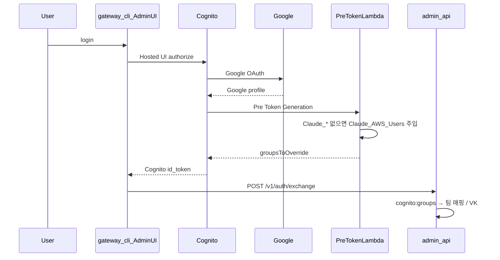

# Cognito Google Federation 설정·구현 가이드

| 항목 | 내용 |
|------|------|
| **목표** | Cognito User Pool에 Google을 Federated IdP로 붙이고, 팀 그룹이 없으면 `Claude_AWS_Users`를 기본으로 쓴다 |
| **적용일** | 2026-11-20 오전 (워킹 트리 / prod 적용). 관련 변경은 아직 단일 git commit으로 묶이지 않았고, 아래 “변경 파일·diff 요약”이 SoT |
| **범위** | gateway-cli / Admin UI (Cognito Hosted UI). 포털(`html/` + `/portal/*`) Google 직접 로그인은 **변경 없음** |
| **계정 SoT** | Federated Cognito 사용자 |

> 앱이 받는 토큰의 issuer는 항상 Cognito이다. Google 토큰은 Cognito 내부에서만 검증되고 앱으로 전달되지 않는다.

---

## 목차

1. [한 줄 요약](#1-한-줄-요약)
2. [동작 흐름](#2-동작-흐름)
3. [포털과의 차이](#3-포털과의-차이)
4. [왜 Pre Token Lambda가 필요한가](#4-왜-pre-token-lambda가-필요한가)
5. [변경 파일·diff 요약 (2026-11-20)](#5-변경-파일diff-요약-2026-11-20)
6. [Terraform — Cognito 모듈](#6-terraform--cognito-모듈)
7. [Pre Token Generation Lambda](#7-pre-token-generation-lambda)
8. [admin-api — named fallback](#8-admin-api--named-fallback)
9. [Helm / 배포](#9-helm--배포)
10. [gateway-cli — identity_provider=Google](#10-gateway-cli--identity_providergoogle)
11. [Google Cloud Console 선행 작업](#11-google-cloud-console-선행-작업)
12. [Terraform apply / Helm 재배포](#12-terraform-apply--helm-재배포)
13. [계정 마이그레이션 (native → federated)](#13-계정-마이그레이션-native--federated)
14. [검증 체크리스트](#14-검증-체크리스트)
15. [범위 밖](#15-범위-밖)

---

## 1. 한 줄 요약

- **포털**은 기존처럼 Google ID token을 admin-api `/portal/*`에서 직접 검증한다 (Cognito 미경유).
- **gateway-cli / Admin UI**는 Cognito Hosted UI에서 Google로 로그인한 뒤, **Cognito가 발급한 `id_token`**으로 VK/세션을 만든다.
- User Pool · Issuer · Client ID는 **기존 풀을 유지**하고, Google IdP와 Pre Token Generation Lambda만 추가한다.
- Google OAuth 클레임에는 그룹이 없으므로, 팀 그룹이 없으면 Pre Token Lambda가 **`Claude_AWS_Users`**를 토큰(및 Cognito 멤버십)에 주입한다.
- admin-api는 `OIDC_DEFAULT_TEAM_GROUP=Claude_AWS_Users`로 Lambda 누락 대비 named fallback을 둔다.

---

## 2. 동작 흐름



단계별로 보면 다음과 같다.

1. 사용자가 `gateway-cli login` 또는 Admin UI 로그인을 시작한다.
2. 브라우저가 Cognito Hosted UI `/oauth2/authorize`로 이동한다 (`identity_provider=Google`이면 Cognito 비밀번호 폼을 건너뛰고 Google로 바로 간다).
3. Cognito가 Google OAuth로 사용자를 보내고, Google 프로필(email, name, sub 등)을 받는다.
4. Cognito가 User Pool에 federated 사용자를 만들거나 갱신한다.
5. **Pre Token Generation Lambda (V2_0)**가 호출된다.
   - 이미 `Claude_*` **팀** 그룹이 있으면 그대로 둔다.
   - 팀 그룹이 없으면 `Claude_AWS_Users`를 `groupsToOverride`에 넣고, 가능하면 `AdminAddUserToGroup`으로 실제 Cognito 멤버십에도 추가한다.
   - `ClaudeAdmin`만 있는 경우는 팀 그룹이 없는 것으로 본다 → `ClaudeAdmin` 유지 + `Claude_AWS_Users` 추가.
6. Cognito가 **자체 `id_token`** (iss = Cognito User Pool)을 앱에 돌려준다. claim `cognito:groups`에 팀 그룹이 실려 있다.
7. CLI/Admin UI가 `POST /v1/auth/exchange` (Bearer Cognito id_token)를 호출한다.
8. admin-api가 Cognito JWKS로 검증하고, `cognito:groups` → 팀 매핑 → 사용자 upsert → Virtual Key(VK) 발급한다.

---

## 3. 포털과의 차이

| 경로 | IdP / 토큰 | 검증 위치 | 프로비저닝 |
|------|------------|-----------|------------|
| gateway-cli / Admin UI | Google → **Cognito id_token** | Cognito JWKS (`OIDC_ISSUER_URL`) | OIDC exchange / Cognito sync |
| 사용자 포털 (`html/`) | **Google ID token** 직접 | Google JWKS (`google_identity.py`) | 안 함. `auth.users` email 매칭만 |

포털은 이 federation 작업의 범위 밖이며 코드를 바꾸지 않는다 (`PORTAL_GOOGLE_CLIENT_ID`, `google_identity.py`, `html/` 유지).

---

## 4. 왜 Pre Token Lambda가 필요한가

Google social IdP OAuth 클레임에는 **그룹이 없다**. 게이트웨이 팀은 Cognito Groups의 `Claude_*` 네이밍에 의존한다.

- 그룹이 Cognito에 이미 배정돼 있으면 → 토큰에 유지
- 팀 그룹이 하나도 없으면 → **`Claude_AWS_Users` 주입**

`Claude_AWS_Users` 파싱 결과(admin-api `_parse_group`):

- 부서 `AWS`
- 팀 `Users`

**주의:** `rejectUnmatchedGroups=true`일 때 기존 fallback은 시드 UUID `DEFAULT_TEAM_ID`(“Default Team”)이지 `Claude_AWS_Users`가 아니다. 플래그만 false로 바꿔도 요구사항이 충족되지 않는다. 그래서 **Lambda 주입이 본체**이고, admin-api `OIDC_DEFAULT_TEAM_GROUP`은 Lambda 누락 대비 방어선이다.

팀 그룹 판별 규칙 (`ClaudeAdmin`은 팀 아님):

| 그룹명 | 팀 그룹? | 결과 |
|--------|----------|------|
| `Claude_AWS-AI-Specialist` | Yes (1 segment) | Default Department / AWS-AI-Specialist |
| `Claude_AWS_Users` | Yes (2 segments) | 부서 AWS / 팀 Users |
| `ClaudeAdmin` | No | 역할 ADMIN만. 팀 매핑 제외 |
| (없음) | — | Lambda가 `Claude_AWS_Users` 주입 |

---

## 5. 변경 파일·diff 요약 (2026-11-20)

오전 적용 기준, 워킹 트리에서 **24 files / +403 / −20** 규모. 핵심은 아래와 같다.

| 영역 | 파일 | 내용 |
|------|------|------|
| Cognito 모듈 | `deployment/terraform/modules/cognito/main.tf` 등 | Google IdP, IdP list, Pre Token Lambda, `Claude_AWS_Users` 그룹 합치기 |
| Lambda (신규) | `deployment/terraform/modules/cognito/lambda/pre_token_gen/handler.py` | 팀 그룹 없으면 `groupsToOverride` + `AdminAddUserToGroup` |
| env | `environments/llm-gateway-{prod,dev}/variables.tf`, `main.tf`, `outputs.tf` | federation / Google secret / default team 변수·출력 |
| admin-api | `config.py`, `oidc_service.py`, `cognito_sync_service.py` | `OIDC_DEFAULT_TEAM_GROUP` named fallback |
| 테스트 (신규) | `admin-api/tests/unit/test_oidc_default_team_group.py` | default group / prefer explicit / reject |
| Helm | `_helpers.tpl`, `values.yaml`, `values-eks-fargate-*.yaml` | env 주입, prod 이미지 `1.0.70-default-team` |
| gateway-cli | `login.py`, `oidc_client.py` | `--identity-provider` / `OIDC_IDENTITY_PROVIDER` |
| 문서 | `07-cognito-onboarding.md`, `mannual_admin.md` | federation 절차 안내 |

포털 관련 파일은 **미수정**.

---

## 6. Terraform — Cognito 모듈

대상: `deployment/terraform/modules/cognito/`

### 6.1 locals — Google on/off, 그룹 합치기, IdP 목록

```hcl
locals {
  user_pool_name = "${var.project}-${var.environment}-userpool"
  # google_client_secret 은 sensitive 라 boolean 표현에 넣으면 output 전체가 sensitive 가 된다.
  # IdP 생성 여부만 client_id 존재로 판정한다.
  google_enabled = var.enable_google_federation && var.google_client_id != ""
  # default_team_group 이 groups 목록에 반드시 포함되도록 합친다.
  effective_groups = distinct(concat(var.groups, [var.default_team_group]))
  identity_providers = local.google_enabled ? ["COGNITO", "Google"] : ["COGNITO"]
}
```

- `COGNITO`를 남겨 native 비밀번호 로그인을 break-glass로 유지한다.
- `effective_groups`로 `Claude_AWS_Users`가 `var.groups`에 없어도 그룹 리소스가 생성된다.

### 6.2 Google Identity Provider

```hcl
resource "aws_cognito_identity_provider" "google" {
  count = local.google_enabled ? 1 : 0

  user_pool_id  = aws_cognito_user_pool.this.id
  provider_name = "Google"
  provider_type = "Google"

  provider_details = {
    client_id        = var.google_client_id
    client_secret    = var.google_client_secret
    authorize_scopes = "profile email openid"
  }

  attribute_mapping = {
    email    = "email"
    username = "sub"
    name     = "name"
  }
}
```

App Client는 `supported_identity_providers = local.identity_providers`이며, Google IdP 생성 후 연결되도록 `depends_on = [aws_cognito_identity_provider.google]`를 둔다.

### 6.3 Pre Token Generation 트리거 (User Pool)

```hcl
dynamic "lambda_config" {
  for_each = var.enable_pre_token_generation ? [1] : []
  content {
    pre_token_generation_config {
      lambda_arn     = aws_lambda_function.pre_token_gen[0].arn
      lambda_version = "V2_0"
    }
  }
}
```

V2_0을 쓰는 이유: `claimsAndScopeOverrideDetails.groupOverrideDetails.groupsToOverride` 형태로 그룹을 덮어쓴다. Lambda 핸들러는 V1/V2 이벤트 shape를 모두 처리한다.

### 6.4 Lambda IAM · 함수

- Runtime: `python3.12`, timeout 10s, memory 128MB
- Env: `OIDC_GROUP_PREFIX`, `OIDC_DEFAULT_TEAM_GROUP`, `ADMIN_GROUP`
- IAM: `cognito-idp:AdminAddUserToGroup` + CloudWatch Logs
- User Pool ARN을 IAM `Resource`에 직접 넣지 않는다 (lambda ↔ pool 순환 의존 방지). 동일 계정 `userpool/*`로 한정.

```hcl
environment {
  variables = {
    OIDC_GROUP_PREFIX       = var.oidc_group_prefix
    OIDC_DEFAULT_TEAM_GROUP = var.default_team_group
    ADMIN_GROUP             = var.admin_group
  }
}
```

### 6.5 모듈 변수 (요약)

| 변수 | 기본값 | 설명 |
|------|--------|------|
| `enable_google_federation` | `false` | Google IdP 추가 |
| `google_client_id` / `google_client_secret` | `""` | Cognito 전용 OAuth (포털 client와 분리 권장) |
| `enable_pre_token_generation` | `true` | Pre Token Lambda |
| `default_team_group` | `Claude_AWS_Users` | 주입/fallback 그룹명 |
| `oidc_group_prefix` | `Claude_` | 팀 그룹 prefix |
| `admin_group` | `ClaudeAdmin` | 팀 매핑 제외 |

### 6.6 prod/dev 환경 배선

`environments/llm-gateway-prod/main.tf` (dev 동일 패턴):

```hcl
module "cognito" {
  # ... 기존 ...
  enable_google_federation    = var.enable_cognito_google_federation
  google_client_id            = var.cognito_google_client_id
  google_client_secret        = var.cognito_google_client_secret
  enable_pre_token_generation = var.enable_cognito_pre_token_generation
  default_team_group          = var.cognito_default_team_group
}
```

prod `cognito_groups` 기본값에 `Claude_AWS_Users` 추가:

```hcl
default = ["Claude_AWS-AI-Specialist", "Claude_AWS_Users", "ClaudeAdmin"]
```

출력:

- `cognito_google_federation_enabled`
- `cognito_oauth_idpresponse_uri` — Google Console Authorized redirect URI
- `cognito_default_team_group`

---

## 7. Pre Token Generation Lambda

파일: `deployment/terraform/modules/cognito/lambda/pre_token_gen/handler.py`

### 7.1 역할

1. 이벤트에서 현재 그룹 목록 읽기 (`groupConfiguration.groupsToOverride` 우선, 없으면 claims).
2. `Claude_*` **팀** 그룹이 하나라도 있으면 그대로 return.
3. 없으면 기존 비팀 그룹(예: `ClaudeAdmin`)을 보존하고 `Claude_AWS_Users`를 append.
4. `groupsToOverride`에 기록 (V1 / V2_0 모두).
5. best-effort로 `AdminAddUserToGroup` — Console / `sync-cognito`와 토큰 일치.

### 7.2 팀 그룹 판별 (admin-api `_parse_group`과 동일 규칙)

```python
GROUP_PREFIX = os.environ.get("OIDC_GROUP_PREFIX", "Claude_")
DEFAULT_TEAM_GROUP = os.environ.get("OIDC_DEFAULT_TEAM_GROUP", "Claude_AWS_Users")

def _is_team_group(name: str) -> bool:
    """Match admin-api OIDCService._parse_group team rules (prefix + 1 or 2 segments)."""
    if not name.startswith(GROUP_PREFIX):
        return False
    tail = name[len(GROUP_PREFIX) :]
    if not tail:
        return False
    parts = tail.split("_")
    if len(parts) == 1:
        return bool(parts[0])
    if len(parts) == 2:
        return bool(parts[0] and parts[1])
    return False
```

`ClaudeAdmin`은 prefix가 `Claude_`가 아니라서 팀 그룹으로 치지 않는다.

### 7.3 응답 shape (V2_0 / V1)

Cognito가 `response` 노드에 `null`을 보내는 경우가 있어 `dict.setdefault`만 쓰면 `AttributeError`가 난다. `_ensure_dict`로 None을 빈 dict로 치환한다.

```python
def _set_groups_override(event: dict[str, Any], groups: list[str]) -> dict[str, Any]:
    version = str(event.get("version") or "1")
    response = _ensure_dict(event, "response")
    if version.startswith("2") or version.startswith("3") or version == "V2_0":
        details = _ensure_dict(response, "claimsAndScopeOverrideDetails")
        group_details = _ensure_dict(details, "groupOverrideDetails")
        group_details["groupsToOverride"] = groups
        if not isinstance(group_details.get("iamRolesToOverride"), list):
            group_details["iamRolesToOverride"] = []
        group_details.setdefault("preferredRole", None)
    else:
        group_details = _ensure_dict(response, "groupOverrideDetails")
        group_details["groupsToOverride"] = groups
    return event
```

### 7.4 handler 본문

```python
def handler(event: dict[str, Any], context: Any) -> dict[str, Any]:
    groups = _current_groups(event)
    has_team = any(_is_team_group(g) for g in groups)

    if has_team:
        logger.info("pre_token.team_group_present groups=%s", groups)
        return event

    out = [g for g in groups if g != DEFAULT_TEAM_GROUP]
    out.append(DEFAULT_TEAM_GROUP)

    user_pool_id = event.get("userPoolId") or ""
    username = event.get("userName") or ""
    if user_pool_id and username and DEFAULT_TEAM_GROUP:
        _ensure_cognito_membership(user_pool_id, username, DEFAULT_TEAM_GROUP)

    return _set_groups_override(event, out)
```

멤버십 추가 실패(그룹 미생성·레이스)는 warning만 남기고, **이번 요청의 토큰 override는 그대로 적용**된다.

---

## 8. admin-api — named fallback

### 8.1 Settings

`admin-api/src/app/core/config.py`:

```python
# 매칭되는 그룹이 하나도 없을 때 동작
#   1) OIDC_DEFAULT_TEAM_GROUP 이 파싱 가능하면 그 팀으로 get_or_create
#   2) 그래도 실패하고 True 이면 거부 (403 no_matching_team_group)
#   3) False 이면 DEFAULT_TEAM_ID (시드 Default Team) 로 fallback
OIDC_REJECT_UNMATCHED_GROUPS: bool = True

# 팀 Claude_* 그룹이 토큰에 없을 때 사용할 Cognito 그룹명.
# 예: Claude_AWS_Users → 부서 AWS / 팀 Users. 비우면 named fallback 생략.
OIDC_DEFAULT_TEAM_GROUP: str = "Claude_AWS_Users"
```

### 8.2 `_resolve_team` (exchange 경로)

`oidc_service.py` — 토큰 그룹에서 `Claude_*` 팀을 못 찾으면:

```python
default_group = (settings.OIDC_DEFAULT_TEAM_GROUP or "").strip()
if default_group:
    parsed = self._parse_group(default_group)
    if parsed is not None:
        dept_name, team_name = parsed
        team = await self._get_or_create_team(
            repo, session, dept_name=dept_name, team_name=team_name,
        )
        logger.info(
            "oidc.default_team_group_applied",
            group=default_group,
            team_id=str(team.id),
        )
        return team.id

if settings.OIDC_REJECT_UNMATCHED_GROUPS:
    raise OIDCNotProvisionableError("no_matching_team_group")
# else → DEFAULT_TEAM_ID
```

로직 한 줄:

```
매칭 Claude_* 없음
  → OIDC_DEFAULT_TEAM_GROUP(Claude_AWS_Users)로 get_or_create_team
  → 성공 시 그 team_id
  → 그래도 실패하면 reject 또는 DEFAULT_TEAM_ID
```

권장 운영: **`rejectUnmatchedGroups=true` 유지 + Lambda 필수**. named fallback은 Lambda/클레임 누락 대비이다.

### 8.3 `_parse_group`

```python
def _parse_group(group_name: str) -> tuple[str | None, str] | None:
    # Claude_team          → (None, "team")  — Default Department
    # Claude_dept_team     → ("dept", "team")
    # ClaudeAdmin / 기타   → None
    ...
```

`Claude_AWS_Users` → `("AWS", "Users")`.

### 8.4 cognito_sync_service

`_resolve_team_id_from_groups`에도 동일 named fallback을 넣어, sync 경로가 exchange와 어긋나지 않게 했다. 실패 시 기존처럼 `DEFAULT_TEAM_ID`.

### 8.5 단위 테스트

`admin-api/tests/unit/test_oidc_default_team_group.py`:

| 테스트 | 입력 그룹 | 기대 |
|--------|-----------|------|
| `test_resolve_team_uses_default_team_group_when_no_claude_team` | `["ClaudeAdmin"]` | `get_or_create(AWS, Users)` |
| `test_resolve_team_prefers_explicit_team_group` | `Claude_AWS-AI-Specialist` | default 미사용, Specialist 팀 |
| `test_resolve_team_rejects_when_default_group_empty_and_reject_true` | Admin만 + default `""` | `no_matching_team_group` |

### 8.6 email 기반 `sso_subject` 재조정 (기존 동작, 컷오버에 중요)

`_upsert_user`는 Cognito `sub`로 먼저 찾고, 없으면 **email로 기존 row를 찾아 `sso_subject`를 갱신**한다. federated 첫 로그인 시 native 계정과 sub가 달라도 DB 사용자를 재사용할 수 있다.

---

## 9. Helm / 배포

### 9.1 chart helper

`deployment/charts/llm-gateway/templates/_helpers.tpl`:

```yaml
- name: OIDC_DEFAULT_TEAM_GROUP
  value: {{ .Values.adminApi.oidc.defaultTeamGroup | default "Claude_AWS_Users" | quote }}
```

### 9.2 values

`values.yaml` / prod:

```yaml
adminApi:
  oidc:
    groupPrefix: "Claude_"
    defaultTeamGroup: "Claude_AWS_Users"
    rejectUnmatchedGroups: true
```

prod 이미지 태그 (admin-api · scheduler 동일 유지):

```yaml
tag: "1.0.70-default-team"
# OIDC_DEFAULT_TEAM_GROUP(Claude_AWS_Users) named fallback
# + Cognito Pre Token Generation 과 맞춤
```

---

## 10. gateway-cli — identity_provider=Google

Hosted UI에서 Cognito 비밀번호 폼을 건너뛰고 Google로 바로 가려면 authorize URL에 `identity_provider=Google`을 붙인다.

### 10.1 OIDCConfig

```python
class OIDCConfig:
    ...
    # Cognito Hosted UI: identity_provider=Google 이면 비밀번호 폼 대신 Google로 바로 이동.
    identity_provider: str = ""
```

환경변수: `OIDC_IDENTITY_PROVIDER`.

### 10.2 authorize 파라미터

```python
params = {
    "response_type": "code",
    "client_id": config.client_id,
    "redirect_uri": redirect_uri,
    "scope": " ".join(config.scopes),
    "state": state,
    "code_challenge": code_challenge,
    "code_challenge_method": "S256",
}
if config.identity_provider:
    params["identity_provider"] = config.identity_provider
```

### 10.3 CLI

```bash
gateway-cli login \
  --issuer-url "$OIDC_ISSUER_URL" \
  --client-id "$OIDC_CLIENT_ID" \
  --identity-provider Google
```

또는:

```bash
export OIDC_IDENTITY_PROVIDER=Google
gateway-cli login
```

옵션을 생략하면 Hosted UI에서 Cognito / Google 중 선택하는 화면이 나온다.

---

## 11. Google Cloud Console 선행 작업

포털용 OAuth client와 **분리**하는 것을 권장한다 (redirect URI·JS origin이 다름). 같은 GCP 프로젝트에 Cognito 전용 Web client를 새로 만든다.

1. Google Cloud Console → APIs & Services → Credentials → OAuth 2.0 Client ID (Web application)
2. **Authorized redirect URI**에 Cognito IdP 콜백을 등록:

```bash
terraform -chdir=deployment/terraform/environments/llm-gateway-prod \
  output -raw cognito_oauth_idpresponse_uri
```

형식:

```
https://<cognito-domain>.auth.<region>.amazoncognito.com/oauth2/idpresponse
```

prod 예 (적용 시점):

```
https://llm-gateway-prod-vanilla-auth-262976740991.auth.ap-northeast-2.amazoncognito.com/oauth2/idpresponse
```

3. Client ID / Secret을 tfvars(또는 CI secret)에 넣는다. **Secret을 git에 커밋하지 말 것.**

동일 client를 포털과 공유하려면 위 idpresponse URI를 그 client에 추가해야 하며, 운영상 분리를 권장한다.

---

## 12. Terraform apply / Helm 재배포

### 12.1 tfvars 예

```hcl
enable_cognito_google_federation    = true
cognito_google_client_id            = "….apps.googleusercontent.com"
cognito_google_client_secret        = "…"
enable_cognito_pre_token_generation = true   # default true
cognito_default_team_group          = "Claude_AWS_Users"
```

### 12.2 apply

```bash
terraform -chdir=deployment/terraform/environments/llm-gateway-prod apply
```

모듈이 하는 일:

- Cognito IdP `Google` 추가, App Client IdP = `COGNITO` + `Google`
- 그룹에 `Claude_AWS_Users` 포함 (없으면 생성)
- Pre Token Generation Lambda (`llm-gateway-prod-cognito-pre-token`) V2_0 연결

### 12.3 Helm

`adminApi.oidc.defaultTeamGroup: "Claude_AWS_Users"` 및 이미지 `1.0.70-default-team` 반영 후 기존 `install-eks` / `helm upgrade` 절차로 admin-api·scheduler 재배포.

### 12.4 prod 배포 상태 (2026-11 기준)

| 항목 | 값 |
|------|-----|
| User Pool | `ap-northeast-2_xa33nFlY3` (기존 유지) |
| App Client | `l5b47iln436rs5ejdcvo17gt7` |
| Google IdP | 등록됨 (`COGNITO` + `Google`) |
| Pre Token Lambda | `llm-gateway-prod-cognito-pre-token` (V2_0) |
| admin-api 이미지 | `1.0.70-default-team` |
| `OIDC_DEFAULT_TEAM_GROUP` | `Claude_AWS_Users` |

---

## 13. 계정 마이그레이션 (native → federated)

코드로 bulk 삭제하지 않는다. 사용자 단위 매뉴얼:

1. (선택) 해당 이메일의 **native Cognito 사용자 삭제** 또는 disable  
   — 같은 email의 native·federated 세션을 동시에 두지 않는다.
2. 동일 Google 계정으로 Hosted UI / `gateway-cli login` (필요 시 `--identity-provider Google`).
3. `_upsert_user`가 **email로 기존 `auth.users`를 찾아 `sso_subject`를 새 Cognito `sub`로 갱신**.
4. 팀이 새로 생기면(AWS/Users) Admin UI에서 **팀 예산** 활성화 ($0 HARD_BLOCK이면 호출 차단).
5. 포털은 기존처럼 같은 email + Google ID token으로 `/portal/*` 사용 (Cognito 미경유).

Federated 첫 로그인 시 Cognito `sub`가 바뀌는 것이 정상이다. email reconcile이 있으므로 DB row는 재사용 가능하다.

---

## 14. 검증 체크리스트

| # | 시나리오 | 기대 |
|---|----------|------|
| 1 | Google federated, Cognito 팀 그룹 없음 | `cognito:groups`에 `Claude_AWS_Users` → VK → 팀 AWS/Users |
| 2 | Google federated + `Claude_AWS-AI-Specialist` | 해당 팀 유지, default **미주입** |
| 3 | Google federated + `ClaudeAdmin`만 | Admin 유지 + `Claude_AWS_Users` → ADMIN + 기본 팀 |
| 4 | 포털 Google 로그인 | `/portal/*` 기존과 동일 (Cognito 미사용) |
| 5 | native Cognito 비밀번호 로그인 | 당분간 가능 (`COGNITO` 유지) |
| 6 | Lambda 장애 / 그룹 누락 | admin-api named fallback으로 AWS/Users |

### 빠른 확인

```bash
export OIDC_ISSUER_URL="$(terraform -chdir=deployment/terraform/environments/llm-gateway-prod output -raw cognito_issuer_url)"
export OIDC_CLIENT_ID="$(terraform -chdir=deployment/terraform/environments/llm-gateway-prod output -raw cognito_client_id)"

gateway-cli login \
  --issuer-url "$OIDC_ISSUER_URL" \
  --client-id "$OIDC_CLIENT_ID" \
  --identity-provider Google
# → Google → VK 캐시

# id_token 의 cognito:groups 확인
python3 -c "
import json, base64, pathlib
t = json.load(open(pathlib.Path.home()/'.gateway-cli/oidc-tokens.json'))['id_token']
p = t.split('.')[1] + '=='
print(json.loads(base64.urlsafe_b64decode(p)).get('cognito:groups'))
"
```

Google로 바로 여는 Hosted UI 예 (client_id·domain은 환경에 맞게):

```
https://<hosted_ui_domain>/oauth2/authorize?client_id=<client>&response_type=code&scope=openid+email+profile&redirect_uri=http://localhost:8090/callback&identity_provider=Google
```

Lambda 로그:

```bash
aws logs tail /aws/lambda/llm-gateway-prod-cognito-pre-token --follow
# pre_token.injected_default_team / pre_token.team_group_present / pre_token.added_to_group
```

---

## 15. 범위 밖

- Entra federation (별도 가이드: `awsome-entraid`)
- 포털을 Cognito SSO로 통합
- Google Workspace 그룹 → `Claude_*` 자동 매핑 (Admin SDK 필요)
- native/DB 계정 자동 삭제 스크립트

---

## 주요 파일 목록

| 경로 | 역할 |
|------|------|
| `deployment/terraform/modules/cognito/main.tf` | Google IdP, Lambda trigger, 그룹 |
| `deployment/terraform/modules/cognito/variables.tf` | federation / default team 변수 |
| `deployment/terraform/modules/cognito/outputs.tf` | idpresponse URI 등 |
| `deployment/terraform/modules/cognito/lambda/pre_token_gen/handler.py` | Pre Token Generation |
| `deployment/terraform/environments/llm-gateway-prod/*` | prod 배선·변수·출력 |
| `admin-api/src/app/core/config.py` | `OIDC_DEFAULT_TEAM_GROUP` |
| `admin-api/src/app/services/oidc_service.py` | `_resolve_team` named fallback |
| `admin-api/src/app/services/cognito_sync_service.py` | sync 경로 동일 fallback |
| `admin-api/tests/unit/test_oidc_default_team_group.py` | 단위 테스트 |
| `deployment/charts/llm-gateway/templates/_helpers.tpl` | env 주입 |
| `deployment/charts/llm-gateway/values*.yaml` | `defaultTeamGroup`, 이미지 태그 |
| `gateway-cli/src/cli/login.py` | `--identity-provider` |
| `gateway-cli/src/gateway_cli_oidc/oidc_client.py` | authorize에 IdP 전달 |
| `deployment/docs/eks-fargate/07-cognito-onboarding.md` | onboarding 문서 갱신 |
| `mannual_admin.md` | 운영 매뉴얼 포인터 |
| `html/`, `google_identity.py` | **변경 없음** (포털) |
